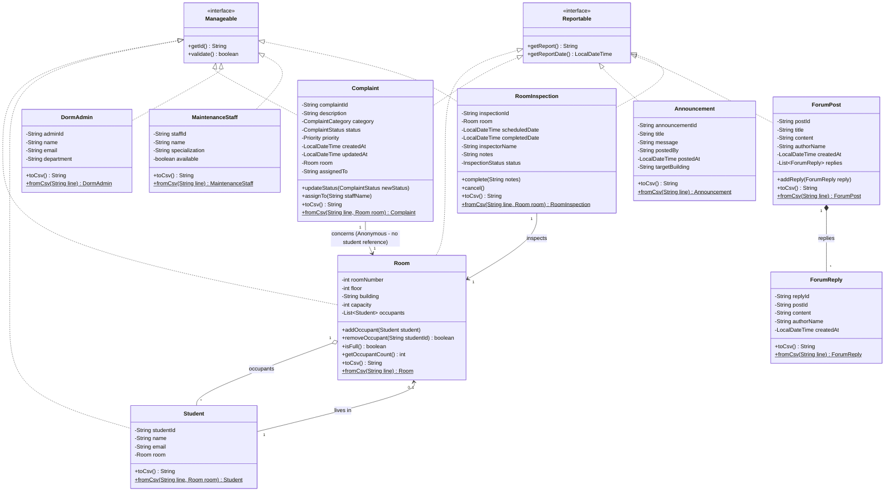

# Dorm Management System

A Java application for managing dormitory operations, including anonymous complaint submission, room management, student forums, announcements, and room inspections.

## Who is it for?

- **Students** — submit anonymous complaints regarding dorm issues (e.g., clogged sinks, ceiling leaks, electrical or heating failures), interact on community forum topics, and view dorm-wide announcements.
- **Administrators** — oversee complaints, assign maintenance personnel, post announcements, organize room inspections, and manage dorm rooms and residents.

---

## Class Diagram (Mermaid)



---

## How to run

### Prerequisites
- JDK 21 (configured in IntelliJ as `ms-21.0.12.1`)
- Maven 3.8+ (IntelliJ bundled Maven located at `C:\Program Files\JetBrains\IntelliJ IDEA 2026.2.3\plugins\maven-plugin\lib\maven3\bin\mvn.cmd`)

### Build
```bash
mvn clean compile
```

### Run Tests (JUnit 5)
```bash
mvn test
```

### Run (Student Mode — default)
```bash
mvn exec:java -Dexec.mainClass="com.dormmanager.Main"
```

### Run (Admin Mode)
```bash
mvn exec:java -Dexec.mainClass="com.dormmanager.Main" -Dexec.args="--mode=admin"
```

### Run with custom config file
```bash
mvn exec:java -Dexec.mainClass="com.dormmanager.Main" -Dexec.args="--config=src/main/resources/config-admin.properties"
```

---

## Requirements Checklist

### Mid-term Project (Week 8) — 10/10 Points Claimed

| # | Requirement | Points | Claimed Location (Package & Class) |
|---|------------|--------|-----------------------------------|
| 1 | **Presentation** | 2p | Presented in class |
| 2 | **The diagram** (≥4 domain classes, ≥2 interfaces, ≥2 collections) | 3p | Classes: [`Room`](src/main/java/com/dormmanager/model/Room.java), [`Student`](src/main/java/com/dormmanager/model/Student.java), [`Complaint`](src/main/java/com/dormmanager/model/Complaint.java), [`DormAdmin`](src/main/java/com/dormmanager/model/DormAdmin.java), [`MaintenanceStaff`](src/main/java/com/dormmanager/model/MaintenanceStaff.java), [`Announcement`](src/main/java/com/dormmanager/model/Announcement.java), [`ForumPost`](src/main/java/com/dormmanager/model/ForumPost.java), [`RoomInspection`](src/main/java/com/dormmanager/model/RoomInspection.java)<br>Interfaces: [`Reportable`](src/main/java/com/dormmanager/interfaces/Reportable.java), [`Manageable`](src/main/java/com/dormmanager/interfaces/Manageable.java)<br>Collections: `List<Student> occupants` in `Room`, `List<ForumReply> replies` in `ForumPost`, `List<Complaint> complaints` in `ComplaintService`, `Map<String, Room> roomMap` in `RoomService` |
| 3 | **Files** (storing & reading back) | 1p | [`FileStorageService`](src/main/java/com/dormmanager/service/FileStorageService.java) handles file persistence (`rooms.dat`, `students.dat`, `complaints.dat`, `announcements.dat`, `forum_posts.dat`, `forum_replies.dat`, `inspections.dat`). |
| 4 | **Config files & program arguments** | 1p* | [`AppConfig`](src/main/java/com/dormmanager/config/AppConfig.java) loads [config.properties](src/main/resources/config.properties) and [config-admin.properties](src/main/resources/config-admin.properties). Supports `--config=<path>` and `--mode=admin\|student`. |
| 5 | **Language exceptions handled** (≥3) | 1p* | Handled in [`FileStorageService`](src/main/java/com/dormmanager/service/FileStorageService.java), [`InputValidator`](src/main/java/com/dormmanager/validation/InputValidator.java), and [`Main`](src/main/java/com/dormmanager/Main.java):<br>1. `java.io.FileNotFoundException`<br>2. `java.io.IOException`<br>3. `java.lang.NumberFormatException`<br>4. `java.lang.SecurityException` |
| 6 | **Custom exceptions** (≥2) | 1p* | [`InvalidRoomException`](src/main/java/com/dormmanager/exception/InvalidRoomException.java)<br>[`DuplicateComplaintException`](src/main/java/com/dormmanager/exception/DuplicateComplaintException.java)<br>[`StudentNotFoundException`](src/main/java/com/dormmanager/exception/StudentNotFoundException.java)<br>[`InvalidInputException`](src/main/java/com/dormmanager/exception/InvalidInputException.java)<br>[`DataLoadException`](src/main/java/com/dormmanager/exception/DataLoadException.java) |
| 7 | **Input validation** | 1p* | [`InputValidator`](src/main/java/com/dormmanager/validation/InputValidator.java) validates student IDs, emails, room numbers, capacities, complaint descriptions (length, content), and sanitizes CSV delimiters before processing. |

---

### Final Project (Weeks 13–14) — Menu Roadmap (13 Points Target)

| # | Requirement | Points | Implementation Plan |
|---|------------|--------|---------------------|
| 1 | **Presentation** | 2p | Presented in class |
| 2 | **Tests** (≥1 test/constructor, ≥3 behaviour tests) | 2p | ✅ **Implemented**: JUnit 5 test suite in `src/test/java/com/dormmanager/` with 13 unit & behavior tests. |
| 3 | **Threads** | 1p* | Multi-threaded client handling / async notifications |
| 4 | **Sockets** | 1p* | Socket client-server communication between student client and dorm server |
| 5 | **Database schema** | 0p* | MySQL schema for rooms, students, complaints, inspections, forum |
| 6 | **JDBC query** | 1p* | Retrieve and display complaints, occupants, and room reports |
| 7 | **JDBC insert/update** | 1p* | Record new complaints, update resolution status and assignments |
| 8 | **Users & roles** | 1p* | Student vs Administrator role-based access control |
| 9 | **Input validation before DB** | 1p* | PreparedStatements + domain sanitization |
| 10 | **JavaFX scenes (3 scenes)** | 3p* | 1. Login / Mode selection scene<br>2. Student Dashboard (Anonymous Complaint submission & Forum)<br>3. Admin Management Dashboard (Complaints dispatch & Inspections) |

---

## Project Structure

```
myproject/
├── pom.xml
├── README.md
├── page_source.txt
├── src/
│   ├── main/
│   │   ├── java/com/dormmanager/
│   │   │   ├── Main.java
│   │   │   ├── config/
│   │   │   │   └── AppConfig.java
│   │   │   ├── exception/
│   │   │   │   ├── DataLoadException.java
│   │   │   │   ├── DuplicateComplaintException.java
│   │   │   │   ├── InvalidInputException.java
│   │   │   │   ├── InvalidRoomException.java
│   │   │   │   └── StudentNotFoundException.java
│   │   │   ├── interfaces/
│   │   │   │   ├── Manageable.java
│   │   │   │   └── Reportable.java
│   │   │   ├── model/
│   │   │   │   ├── Announcement.java
│   │   │   │   ├── Complaint.java
│   │   │   │   ├── ComplaintCategory.java
│   │   │   │   ├── ComplaintStatus.java
│   │   │   │   ├── DormAdmin.java
│   │   │   │   ├── ForumPost.java
│   │   │   │   ├── ForumReply.java
│   │   │   │   ├── InspectionStatus.java
│   │   │   │   ├── MaintenanceStaff.java
│   │   │   │   ├── Priority.java
│   │   │   │   ├── Room.java
│   │   │   │   ├── RoomInspection.java
│   │   │   │   └── Student.java
│   │   │   ├── service/
│   │   │   │   ├── AnnouncementService.java
│   │   │   │   ├── ComplaintService.java
│   │   │   │   ├── FileStorageService.java
│   │   │   │   ├── ForumService.java
│   │   │   │   ├── InspectionService.java
│   │   │   │   ├── RoomService.java
│   │   │   │   └── StudentService.java
│   │   │   └── validation/
│   │   │       └── InputValidator.java
│   │   └── resources/
│   │       ├── config.properties
│   │       └── config-admin.properties
│   └── test/
│       └── java/com/dormmanager/
│           ├── model/
│           │   ├── ComplaintTest.java
│           │   ├── RoomTest.java
│           │   └── StudentTest.java
│           └── service/
│               └── DormServiceTest.java
```
